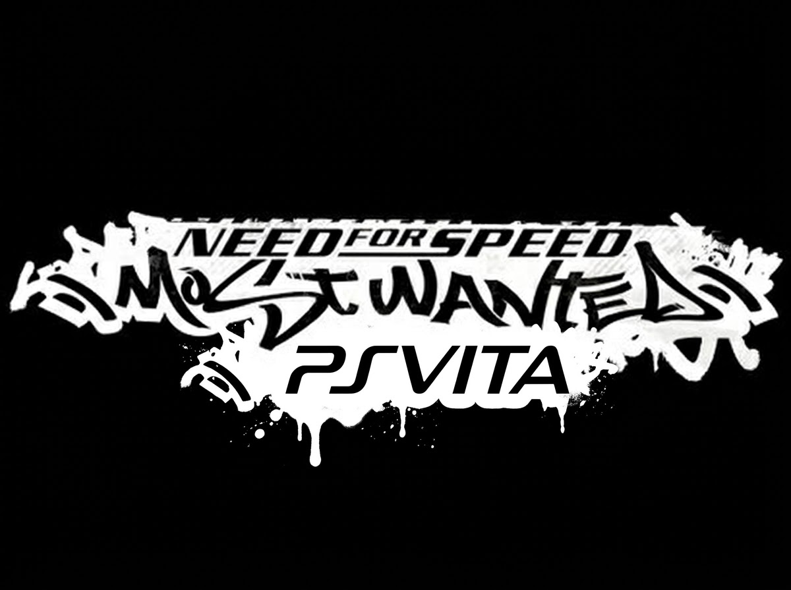

# Need for Speed: Most Wanted for PS Vita

An unofficial port of *Need for Speed: Most Wanted* (PS2, Black Edition, SLUS-21351) to the PS Vita.

> **This project does not include any game data.** You need your own legal copy of the game. The steps below read your disc and prepare the files for the Vita.

## Status

The current state of the port, with what is done and what is still missing, is kept up to date in this [status spreadsheet](https://docs.google.com/spreadsheets/d/1DiEtuSCBstFA1Gxpx7jiJBnwpX0CoKc_1XDqv4upIiQ/edit?usp=sharing).

## Reporting issues

Found a bug or a crash? Please open an issue in the [Issues](../../issues) tab of this repository. Include:

- Your Vita's firmware version and the release you installed.
- What you were doing when the problem happened, and whether it happens again.
- The log file `ux0:data/nfsmw/nfsmw.log`, if the game wrote one.

Check the status spreadsheet first: a known problem may already be listed there.

## What you need

| Item | Why |
| --- | --- |
| A PS Vita with homebrew enabled | To run the game. |
| Your copy of *Need for Speed: Most Wanted* Black Edition for PS2 (SLUS-21351), disc or ISO | The game data comes from it. |
| A computer with Python 3 | To run the data script. Windows, macOS or Linux. |
| ffmpeg (optional) | To prepare the movies. Without it the game runs without movies. |
| About 2 GB free on the computer and on the Vita | The game data is about 1.3 GB and the converted movies about 0.2 GB. |

## Why a script is needed

The PS2 disc does not store file names. The game finds each file by a number computed from its name. The Vita port reads normal files, so the script reads that index and writes each file under its real name. It also converts the movies, because the Vita only plays them in MP4 format.

The script does not download anything, does not change your disc, and writes only into the folder you choose.

## Installation

1. **Install the game** on the Vita: download `nfsmw.vpk` from the [Releases](../../releases) page and install it with VitaShell.
2. **Get the disc contents** on your computer. Extract the ISO with any tool (for example 7-Zip), or copy the disc's files. The folder must contain `SYSTEM.CNF` and the `NFS` folder.
3. **Install ffmpeg** (optional, for the movies). Check that it works by running `ffmpeg -version` in a terminal.
4. **Download this repository** and run the script from its folder:

   ```bash
   python3 scripts/extract-game-data.py "path/to/disc-folder" "path/to/game-data"
   ```

   On Windows, use `python` instead of `python3`.

   The script first copies the game files, then converts the movies one by one, showing its progress. The movies are the slow part: leave it running until it prints `Done`.

5. **Copy the contents of `game-data`** (the folders and files inside it, not the folder itself) to `ux0:data/nfsmw/` on the Vita. Create the `nfsmw` folder inside `data` if it does not exist.
6. **Start the game** from the LiveArea.

### Script options

| Command | What it does |
| --- | --- |
| `python3 scripts/extract-game-data.py DISC OUT` | Copies the game files and converts the movies. Needs ffmpeg for the movies. |
| `python3 scripts/extract-game-data.py DISC OUT --no-movies` | Copies the game files only. No ffmpeg needed. |

Running the script again is safe: it skips the files already in `OUT`, so you can run it again after installing ffmpeg to add the movies.

### Updating from an earlier version

Some versions need game files that earlier versions of the script did not copy. To update:

1. Download the latest `scripts/extract-game-data.py`.
2. Run it again with the same `OUT` folder. It only copies what is missing, so it takes a few seconds.
3. Copy the new files to `ux0:data/nfsmw/`. The release notes list them; for 1.2.0 they are `SOUND/SPEECH/COPSPEECH_EN.IDX` and `SOUND/STREAMS/NISAUDIO.IDX`.
4. Install the new `nfsmw.vpk`.

## What the script does, step by step

- Checks that the disc is *Need for Speed: Most Wanted* Black Edition (SLUS-21351). Any other disc is refused.
- Reads the disc's file index and copies the 1232 game files, byte for byte, into `OUT`.
- Converts the 34 movies with ffmpeg, to MP4 files in `OUT/MOVIES`. The settings match the Vita's video decoder.
- Writes only into `OUT`. It has no network access.

## Troubleshooting

- **"SYSTEM.CNF not found" or "not the root of a PS2 disc":** the folder you gave is not the root of the disc. Choose the folder that contains `SYSTEM.CNF` and `NFS`.
- **"This is not Need for Speed: Most Wanted Black Edition":** the disc is another game or another version.
- **"ffmpeg was not found":** install ffmpeg, or use `--no-movies`.
- **The game runs without movies:** the movies were not converted. Install ffmpeg and run the script again.
- **The game shows an error about missing data:** check the log at `ux0:data/nfsmw/nfsmw.log` and confirm that the `game-data` folder was copied in full.

## Legal notice

This project is not affiliated with or endorsed by Electronic Arts. *Need for Speed* and *Most Wanted* are trademarks of their respective owners. This project does not distribute game data: you need your own legal copy to use it.

## Credits

- [VitaSDK](https://vitasdk.org) and [vitaGL](https://github.com/Rinnegatamante/vitaGL): toolchain and renderer.
- To [dbalatoni13 decompilation](https://github.com/dbalatoni13/nfsmw) which served as starting point for the decompilation for this port. 
